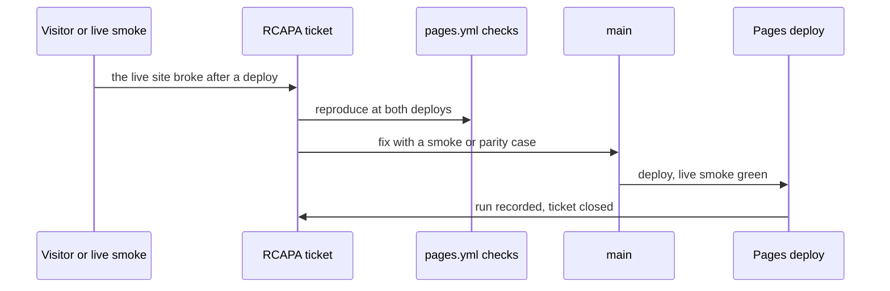

# RCAPA: regressions in a release of swarm-routing/swarm-routing.github.io

An **RCAPA** (root cause analysis with corrective and preventive actions) is
the full record of one **regression in a published release** of this
project: something that worked in a released version and broke after a
change. A bug or change that never reached a release needs none (an
ordinary `bug` issue is enough), and an upstream ns-3 bug is an `NS3-NNN` in
swarm-routing/ns3-tools. The org's rule and its decision table are in
[CONTRIBUTING.md, "RCAPA"](https://github.com/swarm-routing/.github/blob/main/CONTRIBUTING.md#rcapa)
([ADR-0003](https://github.com/swarm-routing/.github/blob/main/docs/adr/0003-rcapa-for-ns3-bugs-and-released-regressions.md)).
This page is the project's flow and its index.

## The flow for this project

What this repository publishes is the **site deploy**:
https://swarm-routing.github.io, deployed from `main` by `pages.yml`, with
AntHocNet's game, docs and API built from the commit pinned in
`protocols.lock`. There are no `v*` tags, so `git tag --contains` does not
apply: a change is published once it is deployed. A regression is something that
worked on the live site and broke after a deploy: the game, a page, a link,
native-vs-WASM parity, accessibility. A defect caught by `pages.yml` on a PR
never deploys and needs no RCAPA. A defect in AntHocNet's core shown by the
game is AntHocNet's (an `AHN` RCAPA there when its release carries it).

| | |
|---|---|
| Published as | the Pages deploy from `main` (`pages.yml`), at the AntHocNet commit `protocols.lock` pins; no tags |
| ID prefix | `SITE-NNN` |
| Ticket | an issue in swarm-routing/swarm-routing.github.io, form *Regression in a release (RCAPA)*, title `[rcapa] SITE-NNN <short description>`, labels `rcapa` and `bug`; name the deploy run that broke it |
| Verified by | the reproducer fails at the failing deploy and passes at the last good one (each a `pages.yml` run on `main`, rebuilt from its commit): `pages.yml` (build, `web/test/parity.sh` native vs WASM byte-identical, both crawls, both browser smokes with axe in day and night) and its live smoke |
| Corrective action | the fix PR (or a `protocols.lock` bump PR when the fix is in AntHocNet); `pages.yml` deploys it on merge |
| Preventive action | a smoke, crawl or parity case that fails on the regression |
| Closes when | the fix is merged **and** a deploy carries it with the live smoke green (run recorded) |

## Index

| ID | RCAPA | RCAPA ticket | Fixed in |
|----|-------|--------------|----------|

## Adding one: the ticket first

1. Open the RCAPA ticket (the table above). `NNN` is the next free number in
   the index.
2. Copy [`_template.md`](_template.md) to `rcapa-<short-description>.md`
   (lowercase, hyphens: what breaks, not where it was found), and add its row
   to the index in the same pull request.
3. The ticket stays open until a deploy carries the fix with the live smoke green; record that `pages.yml` run in the index.

## What an RCAPA answers

1. **What broke, in which release, and who did it touch?** The symptom, the
   releases that fail and the last that passes, the users, numbers or
   downstream pins it affects.
2. **How do I see it myself?** Exact commands, the release or commit, an
   image by tag and digest when one is involved, seeds, expected against
   actual.
3. **Why did it happen, and why did our checks let it into a release?** Five
   whys, each citing its evidence: a source line at a named commit, a log, a
   run, a comment. An answer without a source is a hypothesis and says so.
4. **What does it look like?** Mermaid diagrams: the failing call chain, the
   types or components involved.
5. **What did we do about it?** Corrective actions (the fix, its PR, the
   release that carries it) and preventive actions (the test or check that
   catches a recurrence). An action not done yet is an open issue, linked.
6. **When?** A dated timeline and every link.

## Writing one

- Every issue and PR reference is fully qualified: `swarm-routing/<repo>#N`,
  also for this repository's own items; an ns-3 item is a link whose text is
  `nsnam/ns-3-dev#N` to its full gitlab.com URL. Never a bare number with a
  hash. In a mermaid block, which cannot hold a hash, name the item in words.
- Mermaid: no HTML entities inside a block; write template arguments as
  words.
- An RCAPA is never deleted. Later findings update its status and timeline.
